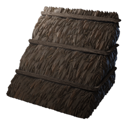

# Plant Fibre Roof Block

| | |
|---|---|
| Category | [Building](../../categories/buildtools.md) |
| Rarity | ⚪ Common |
| Level | - |
| Max stack | 5000 |
| Item ID | `4077117519` |
| Internal name | `Block_Roof_T1_PlantFibre` |

## Description

Used to build thatched roofs. A basic and reliable solution to keeping your head from getting wet.

## Where to find

Workbench

## How to get it

- **Workbench**: 5 × [Plant Fibre](../../items/materials/plant-fibre-3316218728.md) → 50 ×

---

[← Building](../../categories/buildtools.md) · [All categories](../../README.md)
