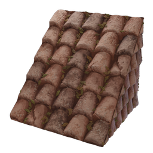

# Roof Tiles Block

| | |
|---|---|
| Category | [Building](../../categories/buildtools.md) |
| Rarity | ⚪ Common |
| Level | - |
| Max stack | 5000 |
| Item ID | `196827131` |
| Internal name | `Block_Roof_T2_Loam_FiredShingle_CRAFTING` |

## Description

A Roof Tiles Block needed to build shingle roofs, commonly seen in construction.

## Where to find

Workbench

## How to get it

- **Workbench**: 4 × [Fired Brick](../../items/materials/fired-brick-1261933427.md), 1 × [Lump of Clay](../../items/materials/lump-of-clay-1925006089.md), 1 × [Plant Fibre](../../items/materials/plant-fibre-3316218728.md) → 50 ×

---

[← Building](../../categories/buildtools.md) · [All categories](../../README.md)
