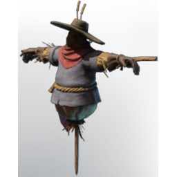

# Scarecrow

| | |
|---|---|
| Category | [Building](../../categories/buildtools.md) |
| Rarity | 🔵 Rare |
| Level | - |
| Max stack | 1 |
| Item ID | `2938349424` |
| Internal name | `Prop_NPC_T3_Scarecrow_ONLY_DECO_FOR_NOW` |

## Description

Often mistaken for the Fell while Enshrouded, it is just a puppet to keep away the animals.

## Lore

> Furniture

## How to get it

- **Farmer**: 4 × [Twig](../../items/materials/twig-1798662696.md), 4 × [Straw](../../items/materials/straw-3921293392.md), 5 × [Torn Cloth](../../items/materials/torn-cloth-1496290527.md), 5 × [String](../../items/materials/string-419344916.md) → 1 ×

---

[← Building](../../categories/buildtools.md) · [All categories](../../README.md) · [JSON](scarecrow-2938349424.json)
