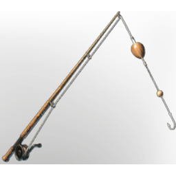

# Simple Fishing Rod

| | |
|---|---|
| Category | [Building](../../categories/buildtools.md) |
| Rarity | ⚪ Common |
| Level | - |
| Max stack | 1 |
| Item ID | `425570534` |
| Internal name | `Tool_T1_FishingRod_basic` |

## Description

A basic simple fishing rod made out of the simplest ingredients. it still allows you to catch common fish

## Stats

| | |
|---|---|
| Slot | Tool |
| Fishing Strength | 1 |
| Fishing Endurance | 30 |

## How to get it

- **an unnamed station**: 2 × [Twig](../../items/materials/twig-1798662696.md), 2 × [Metal Scraps](../../items/materials/metal-scraps-132545371.md), 1 × [String](../../items/materials/string-419344916.md) → 1 ×

---

[← Building](../../categories/buildtools.md) · [All categories](../../README.md)
