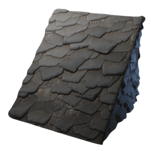

# Stone Shingle Block

| | |
|---|---|
| Category | [Building](../../categories/buildtools.md) |
| Rarity | ⚪ Common |
| Level | - |
| Max stack | 5000 |
| Item ID | `1699388154` |
| Internal name | `Block_Roof_T1_StoneShingles_CRAFTING` |

## Description

The natural way to decorate a roof.

## Where to find

Workbench

## How to get it

- **Workbench**: 5 × [Stone](../../items/materials/stone-631520303.md), 5 × [Flintstone](../../items/materials/flintstone-1586398842.md) → 50 ×

---

[← Building](../../categories/buildtools.md) · [All categories](../../README.md)
