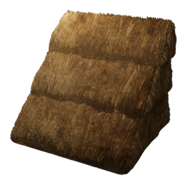

# Straw Roof Block

| | |
|---|---|
| Category | [Building](../../categories/buildtools.md) |
| Rarity | ⚪ Common |
| Level | - |
| Max stack | 5000 |
| Item ID | `551181842` |
| Internal name | `Block_Roof_T3_Straw` |

## Description

Used to build thatched roofs. A basic and reliable solution to keeping your head from getting wet.

## Where to find

Workbench

## How to get it

- **Workbench**: 5 × [Straw](../../items/materials/straw-3921293392.md) → 50 ×

---

[← Building](../../categories/buildtools.md) · [All categories](../../README.md)
