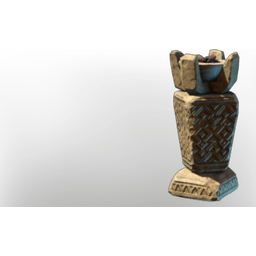

# T3 Medium Stone Brazier

| | |
|---|---|
| Category | [Building](../../categories/buildtools.md) |
| Rarity | ⚪ Common |
| Level | - |
| Max stack | 50 |
| Item ID | `1385502569` |
| Internal name | `Prop_Decoration_Comfort_T3_IlluminationFloor_Brazier_Medium` |

## Description

A decorative Item, which will provide warmth and illumination in its proximitye .

Provides **comfort** which increases the duration of the Rested Bonus.

## Lore

> Hearth

## Stats

| | |
|---|---|
| Comfort - Hearth | 3 |
| Cold Resistance | 3 |

## How to get it

- **Carpenter**: 5 × [Resin](../../items/materials/resin-4109728689.md), 6 × [Lime Stone](../../items/materials/lime-stone-3445636557.md) → 1 ×

---

[← Building](../../categories/buildtools.md) · [All categories](../../README.md)
