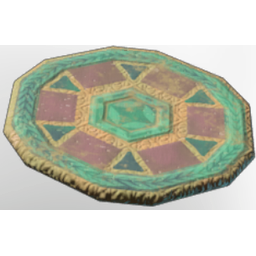

# T4 Carpet

| | |
|---|---|
| Category | [Building](../../categories/buildtools.md) |
| Rarity | ⚪ Common |
| Level | - |
| Max stack | 50 |
| Item ID | `3319129258` |
| Internal name | `Prop_Decoration_Comfort_T4_Floor_Carpet01` |

## Description

A decorative item that can be placed in your home.

Provides **comfort** which increases the duration of the Rested Bonus.

## Lore

> Flooring

## Stats

| | |
|---|---|
| Comfort - Carpet | 4 |

## How to get it

- **Hunter**: 5 × [Fabric](../../items/materials/fabric-2128518559.md), 2 × [Green Mushroom Meat](../../items/materials/green-mushroom-meat-90588998.md), 2 × [Saffron](../../items/materials/saffron-3696168941.md), 2 × [Indigo Plant](../../items/materials/indigo-plant-4276529065.md), 2 × [Sulfur](../../items/materials/sulfur-2819734894.md) → 1 ×

---

[← Building](../../categories/buildtools.md) · [All categories](../../README.md)
