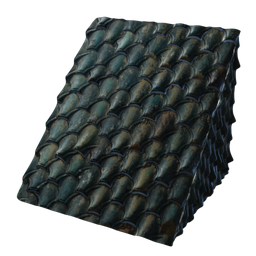

# T4 Desert Shingles

| | |
|---|---|
| Category | [Building](../../categories/buildtools.md) |
| Rarity | ⚪ Common |
| Level | - |
| Max stack | 5000 |
| Item ID | `3899129081` |
| Internal name | `Block_Roof_T4_Desert_Shingles_01_Reward` |

## Description

T4 Desert Shingles made from Copper

## Where to find

Workbench

## How to get it

- **Workbench**: 10 × [Lump of Clay](../../items/materials/lump-of-clay-1925006089.md), 1 × [Bronze Bars](../../items/materials/bronze-bars-642002617.md), 1 × [Lapislazuli](../../items/materials/lapislazuli-3044860358.md) → 50 ×

---

[← Building](../../categories/buildtools.md) · [All categories](../../README.md) · [JSON](t4-desert-shingles-3899129081.json)
