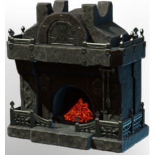

# T5 Prop Decoration Comfort Hearth Granite

| | |
|---|---|
| Category | [Building](../../categories/buildtools.md) |
| Rarity | ⚪ Common |
| Level | - |
| Max stack | 50 |
| Item ID | `1470377793` |
| Internal name | `Prop_Decoration_Comfort6_T5_Hearth_Granite` |

## Description

A fire place that can be placed in your home to provide warmth. It's basic but does the trick helping you to get a good rested buff.

## Lore

> Hearth

## Stats

| | |
|---|---|
| Cold Resistance | 4 |
| Comfort - Hearth | 6 |

## How to get it

- **Carpenter**: 2 × T5 Material Coal Name, 20 × T5 Material Granite, 2 × T5 Steel Bar Desc → 1 ×

---

[← Building](../../categories/buildtools.md) · [All categories](../../README.md) · [JSON](t5-prop-decoration-comfort-hearth-granite-1470377793.json)
