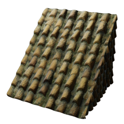

# T6 Shellime Clay Shingles

| | |
|---|---|
| Category | [Building](../../categories/buildtools.md) |
| Rarity | ⚪ Common |
| Level | - |
| Max stack | 5000 |
| Item ID | `4234622287` |
| Internal name | `Block_Roof_T6_Shellime_PirateBay_Shingles_REWARD` |

## Description

t6 shellime clay shingles description

## Where to find

Workbench

## How to get it

- **Workbench**: 5 × [Lump of Clay](../../items/materials/lump-of-clay-1925006089.md), 5 × T6 material limestone from shells → 50 ×

---

[← Building](../../categories/buildtools.md) · [All categories](../../README.md) · [JSON](t6-shellime-clay-shingles-4234622287.json)
