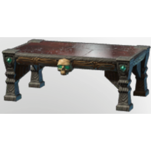

# Table Medium T2 Dungeon

| | |
|---|---|
| Category | [Building](../../categories/buildtools.md) |
| Rarity | ⚪ Common |
| Level | - |
| Max stack | 50 |
| Item ID | `2950858301` |
| Internal name | `Prop_Decoration_Comfort3_T2_Table_Medium_HollowHalls` |

## Description

A decorative item that can be placed in your home.

Provides **comfort** which increases the duration of the Rested Bonus.

## Lore

> Furniture

## Stats

| | |
|---|---|
| Comfort - Table | 3 |

## How to get it

- **Collector**: 12 × [Fog Wood](../../items/materials/fog-wood-1320899587.md), 6 × [Nails](../../items/materials/nails-2743545700.md), 2 × [Red Marble fragment](../../items/materials/red-marble-fragment-2530601241.md), 8 × [Bones](../../items/materials/bones-2053375978.md), 4 × [Krypt Krystal](../../items/materials/krypt-krystal-3953523416.md) → 1 ×

---

[← Building](../../categories/buildtools.md) · [All categories](../../README.md) · [JSON](table-medium-t2-dungeon-2950858301.json)
