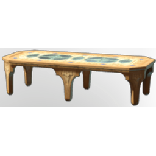

# Table T4 large

| | |
|---|---|
| Category | [Building](../../categories/buildtools.md) |
| Rarity | ⚪ Common |
| Level | - |
| Max stack | 50 |
| Item ID | `3011227787` |
| Internal name | `Prop_Decoration_Comfort5_T4_Table_Large` |

## Description

A decorative item that can be placed in your home.

Provides **comfort** which increases the duration of the Rested Bonus.

## Lore

> Furniture

## Stats

| | |
|---|---|
| Comfort - Table | 5 |

## How to get it

- **Carpenter**: 14 × [Palmwood Logs](../../items/materials/palmwood-logs-2955233340.md), 20 × [Lapislazuli](../../items/materials/lapislazuli-3044860358.md), 4 × [Nails](../../items/materials/nails-2743545700.md), 4 × [Resin](../../items/materials/resin-4109728689.md), 10 × [Glass](../../items/materials/glass-2246309017.md) → 1 ×

---

[← Building](../../categories/buildtools.md) · [All categories](../../README.md) · [JSON](table-t4-large-3011227787.json)
