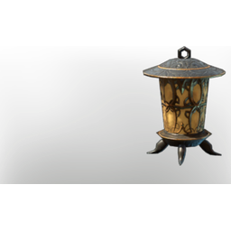

# Throneroom Floor Lamp

| | |
|---|---|
| Category | [Building](../../categories/buildtools.md) |
| Rarity | ⚪ Common |
| Level | - |
| Max stack | 50 |
| Item ID | `678777236` |
| Internal name | `Prop_Decoration_Comfort_T6_IlluminationFloor_Throneroom` |

## Description

An illumination item that can be placed in your home.

Provides **comfort** which increases the duration of the Rested Bonus.

## Lore

> Illumination

## Stats

| | |
|---|---|
| Comfort - Illumination | 6 |

## How to get it

- **Carpenter**: 2 × [Glass](../../items/materials/glass-2246309017.md), 4 × T5 Steel Bar Desc, 5 × [Gold Dust](../../items/materials/gold-dust-1060230019.md) → 1 ×

---

[← Building](../../categories/buildtools.md) · [All categories](../../README.md)
