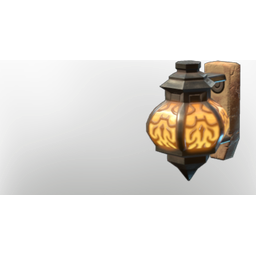

# Wall Lantern

| | |
|---|---|
| Category | [Building](../../categories/buildtools.md) |
| Rarity | ⚪ Common |
| Level | - |
| Max stack | 50 |
| Item ID | `2560383707` |
| Internal name | `Prop_Decoration_Comfort_T4_IlluminationWall` |

One of 2 versions of this item: see [Wall Lantern](../../objects/buildtools/wall-lantern.md) for all of them and how they differ.

## Description

An illumination item that can be placed in your home.

Provides **comfort** which increases the duration of the Rested Bonus.

## Lore

> Illumination

## Stats

| | |
|---|---|
| Comfort - Illumination | 5 |

## How to get it

- **Carpenter**: 1 × [Iron Bars](../../items/materials/iron-bars-159114158.md), 2 × [Charcoal](../../items/materials/charcoal-372029138.md), 2 × [Glass](../../items/materials/glass-2246309017.md), 2 × [Goo](../../items/materials/goo-3403995938.md), 2 × [Glow Dirt](../../items/materials/glow-dirt-3152907053.md) → 1 ×

---

[← Building](../../categories/buildtools.md) · [All categories](../../README.md) · [JSON](wall-lantern-2560383707.json)
