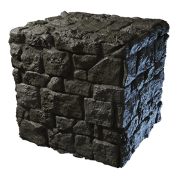

# Weathered Stone Block

| | |
|---|---|
| Category | [Building](../../categories/buildtools.md) |
| Rarity | ⚪ Common |
| Level | - |
| Max stack | 5000 |
| Item ID | `1406367026` |
| Internal name | `Block_T2_Dungeon_Stone_Catacombs_REWARD` |

## Description

In ancient times, these blocks were used to build dungeons and catacombs. Nowadays, they are in bad condition, but still server their purpose.

## Where to find

Workbench

## How to get it

- **Workbench**: 5 × [Stone](../../items/materials/stone-631520303.md), 5 × [Deepforest Stone](../../items/materials/deepforest-stone-1181280513.md) → 100 ×

---

[← Building](../../categories/buildtools.md) · [All categories](../../README.md) · [JSON](weathered-stone-block-1406367026.json)
