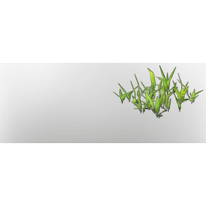

# Wheat Seedling

| | |
|---|---|
| Category | [Building](../../categories/buildtools.md) |
| Rarity | ⚪ Common |
| Level | - |
| Max stack | 100 |
| Item ID | `1811689543` |
| Internal name | `T3_Seedling_Grain_Wheat` |

## Description

A seedling that will grow into a plant when sown in the right soil. Once fully grown, it can be harvested once.

## Lore

> Seedlings

## Where to find

Seedbed

## How to get it

- **Seedbed**: 1 × [Wheat Grains](../../items/materials/wheat-grains-2435149273.md), 1 × [Fossilized Bone Dust](../../items/materials/fossilized-bone-dust-3073226096.md) → 5 ×

---

[← Building](../../categories/buildtools.md) · [All categories](../../README.md)
