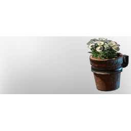

# White Wall Pot

| | |
|---|---|
| Category | [Building](../../categories/buildtools.md) |
| Rarity | ⚪ Common |
| Level | - |
| Max stack | 50 |
| Item ID | `1763603908` |
| Internal name | `Flower_Pot_Small_Wall_White` |

One of 2 versions of this item: see [White Wall Pot](../../objects/buildtools/white-wall-pot.md) for all of them and how they differ.

## Description

A small potted plant to beautify your home.

## Lore

> Potted Plant

## How to get it

- **Farmer**: 4 × [Empty Flower Pot III](../../items/buildtools/empty-flower-pot-iii-1882339175.md), 1 × [Flower Soil](../../items/materials/flower-soil-3604850591.md), 1 × [Metal Scraps](../../items/materials/metal-scraps-132545371.md), 1 × [Charcoal](../../items/materials/charcoal-372029138.md) → 4 ×

---

[← Building](../../categories/buildtools.md) · [All categories](../../README.md)
