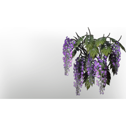

# Wisteria (Overgrowth Plant)

| | |
|---|---|
| Category | [Building](../../categories/buildtools.md) |
| Rarity | ⚪ Common |
| Level | 40 |
| Max stack | 1000 |
| Item ID | `594839802` |
| Internal name | `Material_T6_Overgrowth_Wisteria` |

## Description

Use this material to decorate any voxel material using the ??? tool

## Lore

> Plants

## Where to find

Farmer

## How to get it

- **Farmer**: 2 × [T6 Wetlands Dirt](../../items/materials/t6-wetlands-dirt-4095370049.md), 3 × [Passionflower](../../items/materials/passionflower-4148439656.md) → 100 ×

---

[← Building](../../categories/buildtools.md) · [All categories](../../README.md) · [JSON](wisteria-overgrowth-plant-594839802.json)
