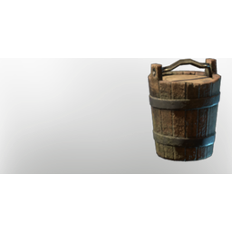

# Wood Bucket

| | |
|---|---|
| Category | [Building](../../categories/buildtools.md) |
| Rarity | ⚪ Common |
| Level | - |
| Max stack | 20 |
| Item ID | `3107844914` |
| Internal name | `Prop_Decoration_T2_Bucket_Wood` |

## Description

A decorative object to design and beautify yout home.

## Lore

> Furniture

## Where to find

Carpenter

## How to get it

- **Carpenter**: 2 × [Wood Planks](../../items/materials/wood-planks-1626290897.md), 1 × [Metal Sheets](../../items/materials/metal-sheets-4271896226.md), 1 × [Charcoal](../../items/materials/charcoal-372029138.md) → 1 ×

## Used to make

[Improved Water Well](../../items/buildtools/improved-water-well-1155756187.md), [Water Well](../../items/buildtools/water-well-2136474329.md)

---

[← Building](../../categories/buildtools.md) · [All categories](../../README.md) · [JSON](wood-bucket-3107844914.json)
