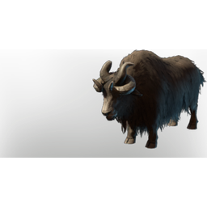

# Yak

| | |
|---|---|
| Category | [Building](../../categories/buildtools.md) |
| Rarity | ⚪ Common |
| Level | - |
| Max stack | 1 |
| Item ID | `3586346410` |
| Internal name | `Animal_Farming_Yak` |

## Description

This woolly fellow grows a thick coat to weather the harsh climate of Biom. It can be shaved for wool.

## Lore

> Farming Animal

---

[← Building](../../categories/buildtools.md) · [All categories](../../README.md)
