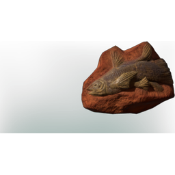

# Fish Fossil

| | |
|---|---|
| Category | [Collectibles](../../categories/collectibles.md) |
| Rarity | 🔵 Rare |
| Level | - |
| Max stack | 20 |
| Item ID | `3948502627` |
| Internal name | `Collection_fossils_06_seaCreatures_fish_01` |

## Description

The fossilized remains of a fish. Decendents of this fish used to populate the brooks and springs of embervale before the shroud consumed them. Perhaps there is still life deep inside those toxin filled trenches... but consumption is most likely ill advised.

---

[← Collectibles](../../categories/collectibles.md) · [All categories](../../README.md)
