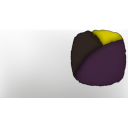

# Passionflower at night

| | |
|---|---|
| Category | [Color Palettes](../../categories/colorpalette.md) |
| Rarity | ⚪ Common |
| Level | - |
| Max stack | 50 |
| Item ID | `2979937043` |
| Internal name | `ColorPalette_T6_ColorPalette_night_04` |

## Description

When the darkness creeps in the passionflowers start to bloom. In the dark night there petals can turn into a muted pink, appearing almost purple, but there core will always glow brightly. This palette can be made with Wetland materials.

## Where to find

Coloring Station

## How to get it

- **Coloring Station**: 1 × [Shroud Sludge](../../items/materials/shroud-sludge-1887186828.md), 1 × [Passionflower](../../items/materials/passionflower-4148439656.md), 1 × [Gold Dust](../../items/materials/gold-dust-1060230019.md), 1 × T5 Material Granite → 5 ×

---

[← Color Palettes](../../categories/colorpalette.md) · [All categories](../../README.md)
