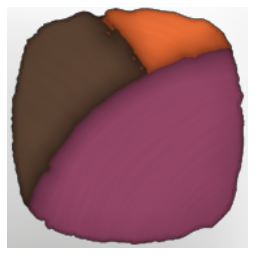

# Rust And Rose

| | |
|---|---|
| Category | [Color Palettes](../../categories/colorpalette.md) |
| Rarity | ⚪ Common |
| Level | - |
| Max stack | 50 |
| Item ID | `2331607035` |
| Internal name | `ColorPalette_T6_ColorPalette_08` |

## Description

This color palette blends muted orange, soft mauve, and earthy brown into a palette that feels both weathered and graceful — like warmth preserved in fading light. This palette can be made with Wetland materials.

## Where to find

Coloring Station

## How to get it

- **Coloring Station**: 1 × [Shroud Sludge](../../items/materials/shroud-sludge-1887186828.md), 2 × [Fertilised Farm Soil](../../items/materials/fertilised-farm-soil-260133819.md), 2 × [Passionflower](../../items/materials/passionflower-4148439656.md), 1 × [Daylily Flower](../../items/materials/daylily-flower-1897605064.md) → 5 ×

---

[← Color Palettes](../../categories/colorpalette.md) · [All categories](../../README.md)
