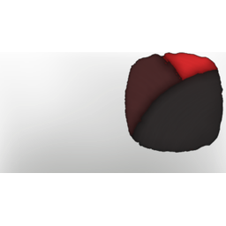

# Shades Of Red

| | |
|---|---|
| Category | [Color Palettes](../../categories/colorpalette.md) |
| Rarity | ⚪ Common |
| Level | - |
| Max stack | 50 |
| Item ID | `835723769` |
| Internal name | `ColorPalette_T6_ColorPalette_night_02` |

## Description

Dark and muted hues of red create the perfect color combination for a night walk

## Where to find

Coloring Station

## How to get it

- **Coloring Station**: 1 × [Shroud Sludge](../../items/materials/shroud-sludge-1887186828.md), 1 × T5 Material Granite, 2 × [Sulfur](../../items/materials/sulfur-2819734894.md), 1 × [Passionflower](../../items/materials/passionflower-4148439656.md) → 5 ×

---

[← Color Palettes](../../categories/colorpalette.md) · [All categories](../../README.md)
