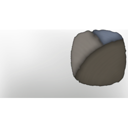

# T1 Palette 04 Brown blue grey

| | |
|---|---|
| Category | [Color Palettes](../../categories/colorpalette.md) |
| Rarity | ⚪ Common |
| Level | - |
| Max stack | 50 |
| Item ID | `2299237068` |
| Internal name | `ColorPalette_T1_ColorPalette_04` |

## Description

Shades of brown and blue

## Where to find

Coloring Station

## How to get it

- **Coloring Station**: 1 × [Fog Liquid](../../items/materials/fog-liquid-860644516.md), 1 × [Night Lily](../../items/consumables/night-lily-2433487720.md), 2 × [Dirt](../../items/materials/dirt-1558115984.md), 2 × [Penny Bun](../../items/consumables/penny-bun-600862405.md) → 5 ×

---

[← Color Palettes](../../categories/colorpalette.md) · [All categories](../../README.md) · [JSON](t1-palette-04-brown-blue-grey-2299237068.json)
