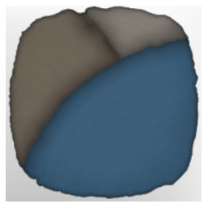

# T2 Palette 04 Grey and Blue

| | |
|---|---|
| Category | [Color Palettes](../../categories/colorpalette.md) |
| Rarity | ⚪ Common |
| Level | - |
| Max stack | 50 |
| Item ID | `389689356` |
| Internal name | `ColorPalette_T2_ColorPalette_04` |

## Description

Different shades of blue and grey

## Where to find

Coloring Station

## How to get it

- **Coloring Station**: 1 × [Goo](../../items/materials/goo-3403995938.md), 2 × [Indigo Plant](../../items/materials/indigo-plant-4276529065.md), 2 × [Lump of Clay](../../items/materials/lump-of-clay-1925006089.md), 1 × [Shroud Mush](../../items/materials/shroud-mush-4229884102.md) → 5 ×

---

[← Color Palettes](../../categories/colorpalette.md) · [All categories](../../README.md)
