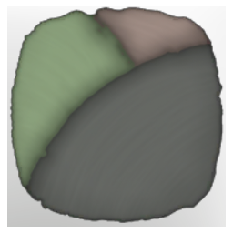

# Tbd T3 Palette 03 Reward

| | |
|---|---|
| Category | [Color Palettes](../../categories/colorpalette.md) |
| Rarity | ⚪ Common |
| Level | - |
| Max stack | 50 |
| Item ID | `1361344405` |
| Internal name | `ColorPalette_T3_ColorPalette_Reward_03` |

## Description

tbd T3 Palette 03 description

## Where to find

Coloring Station

## How to get it

- **Coloring Station**: 1 × [Ammoniak Gland](../../items/materials/ammoniak-gland-2027586500.md), 2 × [Tin Ore](../../items/materials/tin-ore-3749540900.md), 2 × [Green Mushroom Meat](../../items/materials/green-mushroom-meat-90588998.md), 1 × [Aurum Lily](../../items/materials/aurum-lily-2341333485.md) → 5 ×

---

[← Color Palettes](../../categories/colorpalette.md) · [All categories](../../README.md)
