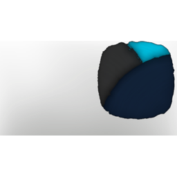

# Veil Of Blues

| | |
|---|---|
| Category | [Color Palettes](../../categories/colorpalette.md) |
| Rarity | ⚪ Common |
| Level | - |
| Max stack | 50 |
| Item ID | `391330740` |
| Internal name | `ColorPalette_T6_ColorPalette_night_01` |

## Description

The Veilwater Basin is rich in vibrant colors. The blue sky reflecting in the clear waters. and at night, tand at night, the waters glow faintly, as if holding onto the memory of the day’s colors.

## Where to find

Coloring Station

## How to get it

- **Coloring Station**: 1 × [Shroud Sludge](../../items/materials/shroud-sludge-1887186828.md), 2 × [Gleam Root Dust](../../items/materials/gleam-root-dust-3507051762.md), 2 × [Aquamarine Dust](../../items/materials/aquamarine-dust-554104227.md), 1 × T5 Material Granite → 5 ×

---

[← Color Palettes](../../categories/colorpalette.md) · [All categories](../../README.md)
