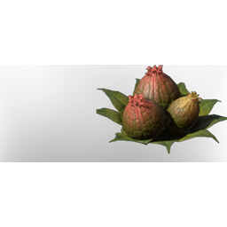

# Algae Buds

| | |
|---|---|
| Category | [Consumables](../../categories/consumables.md) |
| Rarity | ⚪ Common |
| Level | - |
| Max stack | 20 |
| Item ID | `2448218322` |
| Internal name | `Food_T6_raw_bad_herb_AlgaeBuds` |

## Description

The Buds of the Algae Plant. Raw inedible, but you can dry them.

## Where to find

find in T6 underwater

## Stats

| | |
|---|---|
| Health | -80 |
| Stamina | -70 |

## Used to make

[Swim Sprint Stamina Reduction Flask](../../items/consumables/swim-sprint-stamina-reduction-flask-3254225118.md), [Grilled Algae Buds](../../items/consumables/grilled-algae-buds-3423336686.md)

---

[← Consumables](../../categories/consumables.md) · [All categories](../../README.md)
