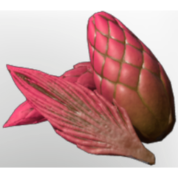

# Ancient "Artichoke"

| | |
|---|---|
| Category | [Consumables](../../categories/consumables.md) |
| Rarity | ⚪ Common |
| Level | - |
| Max stack | 20 |
| Item ID | `426586658` |
| Internal name | `Food_T7_raw_fruit_Artichoke` |

## Description

It looks like an Artichoke but its a fruit! Filled with much fruit juice and a sweet flesh.

## Where to find

Ancient Land

## Stats

| | |
|---|---|
| Duration | 3:30 min |
| Health Regeneration | 24 |

## Used to make

[Fancy Fruit Juice](../../items/consumables/fancy-fruit-juice-1603269825.md), [Fruit Salad](../../items/consumables/fruit-salad-270916101.md), [Ancient "Artichoke" Seedling](../../items/buildtools/ancient-artichoke-seedling-3397770029.md)

---

[← Consumables](../../categories/consumables.md) · [All categories](../../README.md)
