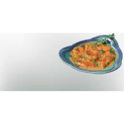

# Ancient Cabbage Rolls

| | |
|---|---|
| Category | [Consumables](../../categories/consumables.md) |
| Rarity | 🟢 Uncommon |
| Level | - |
| Max stack | 20 |
| Item ID | `232113931` |
| Internal name | `Food_T7_dish_meat_CabbageRolls` |

## Description

cabbage rolls made out of big ancient cabbage leaves

## Where to find

Kitchen

## Stats

| | |
|---|---|
| Duration | 60:00 min |
| Stamina Regeneration | 12 |
| Health | 320 |

## How to get it

- **Kitchen**: 5 × [Ancient "Cabbage" Leaves](../../items/consumables/ancient-cabbage-leaves-1682430863.md), 5 × [T5 Raw Fat Meat](../../items/consumables/t5-raw-fat-meat-2306767560.md), 3 × [Salt](../../items/materials/salt-1564406835.md) → 5 ×

---

[← Consumables](../../categories/consumables.md) · [All categories](../../README.md)
