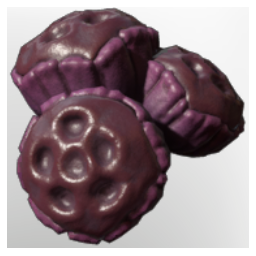

# Ancient "Pomegranate"

| | |
|---|---|
| Category | [Consumables](../../categories/consumables.md) |
| Rarity | ⚪ Common |
| Level | - |
| Max stack | 20 |
| Item ID | `1321928315` |
| Internal name | `Food_T7_raw_fruit_Pomegranate` |

## Description

an ancient fruit crossbreed, reminds you of a pomegranate, but the "whsikers" tickle conspicuously in the throat

## Where to find

Ancient Land

## Stats

| | |
|---|---|
| Health Regeneration | 24 |
| Duration | 3:30 min |

## Used to make

[Fancy Fruit Juice](../../items/consumables/fancy-fruit-juice-1603269825.md), [Ancient Pomegranate Tarte](../../items/consumables/ancient-pomegranate-tarte-2202063914.md), [Fruit Salad](../../items/consumables/fruit-salad-270916101.md), [Ancient "Pomegranate" Seedling](../../items/buildtools/ancient-pomegranate-seedling-3166342350.md)

---

[← Consumables](../../categories/consumables.md) · [All categories](../../README.md) · [JSON](ancient-pomegranate-1321928315.json)
