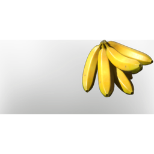

# Banana

| | |
|---|---|
| Category | [Consumables](../../categories/consumables.md) |
| Rarity | ⚪ Common |
| Level | - |
| Max stack | 20 |
| Item ID | `2626897582` |
| Internal name | `Food_T6_raw_fruit_YellowBanana` |

## Description

ripe yellow banana can be eaten raw or used in another dish

## Where to find

Veilwater Basin

## Stats

| | |
|---|---|
| Health Regeneration | 21 |
| Duration | 3:00 min |

## Used to make

[Banana Coconut Smoothie](../../items/consumables/banana-coconut-smoothie-1444162950.md), [Honey Baked Banana with Cashews](../../items/consumables/honey-baked-banana-with-cashews-3556995300.md), [Dried Banana Chips](../../items/consumables/dried-banana-chips-1717387680.md), [Banana Seedling](../../items/buildtools/banana-seedling-3955544954.md)

---

[← Consumables](../../categories/consumables.md) · [All categories](../../README.md)
