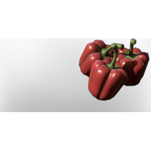

# Bell Pepper

| | |
|---|---|
| Category | [Consumables](../../categories/consumables.md) |
| Rarity | ⚪ Common |
| Level | - |
| Max stack | 20 |
| Item ID | `4094316095` |
| Internal name | `Food_T3_raw_vegetable_RedPepper` |

## Description

A plant of sweet flavour and powerful red colour. Grants the user dexterity upon consumption.

## Where to find

Nomad Highlands

## Stats

| | |
|---|---|
| Duration | 15:00 min |
| % Dagger Damage | 9 |
| Ranged Damage | 9 |

## Used to make

[Chicken Soup](../../items/consumables/chicken-soup-1730813213.md), [Plantain Salad with ancient beans](../../items/consumables/plantain-salad-with-ancient-beans-3497094022.md), [T6 Taro Root Curry](../../items/consumables/t6-taro-root-curry-4124427746.md), [Stir-Fried Vegetables](../../items/consumables/stir-fried-vegetables-1105965780.md), [Vegetable Soup](../../items/consumables/vegetable-soup-3049932278.md), [Rice with ancient "beans"](../../items/consumables/rice-with-ancient-beans-2074901818.md), [T6 Fried Rice](../../items/consumables/t6-fried-rice-2285189073.md), [Pepper Seedling](../../items/buildtools/pepper-seedling-2330783516.md), [Food Turkey Feeding](../../items/buildtools/food-turkey-feeding-2553328095.md)

---

[← Consumables](../../categories/consumables.md) · [All categories](../../README.md)
