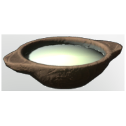

# Catdeer milk

| | |
|---|---|
| Category | [Consumables](../../categories/consumables.md) |
| Rarity | 🟢 Uncommon |
| Level | - |
| Max stack | 100 |
| Item ID | `3774403584` |
| Internal name | `Food_T2_processed_hydration_CatdeerMilk` |

## Description

A delicious jug of Catdeer milk. Drinking it will grant you endurance and recharge your stamina faster!

## Where to find

Cooking Station

## Stats

| | |
|---|---|
| Stamina | 20 |
| Stamina Regeneration | 15 |
| Duration | 25:00 min |

## How to get it

- **Cooking Station**: 1 × [Honey](../../items/consumables/honey-227143323.md), 4 × [Uncoocked Catdeer Milk](../../items/consumables/uncoocked-catdeer-milk-2012645754.md) → 5 ×

---

[← Consumables](../../categories/consumables.md) · [All categories](../../README.md)
