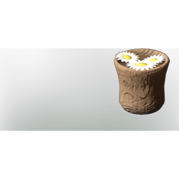

# Chamomile Tea

| | |
|---|---|
| Category | [Consumables](../../categories/consumables.md) |
| Rarity | 🟢 Uncommon |
| Level | - |
| Max stack | 20 |
| Item ID | `2337909498` |
| Internal name | `Food_T2_dish_hydration_ChamomileTea` |

## Description

A very healthy brewage that helps the body recover and helps with sleeping issues.

## Where to find

Kitchen

## Stats

| | |
|---|---|
| Duration | 35:00 min |
| Stamina | 20 |
| Health Regeneration | 12 |

## How to get it

- **Kitchen**: 5 × [Chamomile](../../items/materials/chamomile-3478847834.md) → 5 ×

## Used to make

[T4 Eternal Heal Channel I](../../items/ammunition/t4-eternal-heal-channel-i-2337136795.md)

---

[← Consumables](../../categories/consumables.md) · [All categories](../../README.md)
