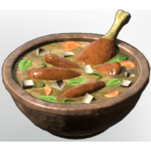

# Chicken Soup

| | |
|---|---|
| Category | [Consumables](../../categories/consumables.md) |
| Rarity | 🟢 Uncommon |
| Level | - |
| Max stack | 20 |
| Item ID | `1730813213` |
| Internal name | `Food_T3_dish_meat_ChickenSoup` |

## Description

A very healthy soup made by boiling chicken over a period of time. An old house maidens dish to help the body against illness.

## Where to find

Kitchen

## Stats

| | |
|---|---|
| Duration | 40:00 min |
| Health | 160 |
| % Dagger Damage | 6 |
| Ranged Damage | 6 |

## How to get it

- **Kitchen**: 3 × [Forest Beet](../../items/consumables/forest-beet-3542827745.md), 1 × [Salt](../../items/materials/salt-1564406835.md), 3 × [Raw Bird Meat](../../items/consumables/raw-bird-meat-385885887.md), 3 × [Bell Pepper](../../items/consumables/bell-pepper-4094316095.md) → 5 ×

---

[← Consumables](../../categories/consumables.md) · [All categories](../../README.md) · [JSON](chicken-soup-1730813213.json)
