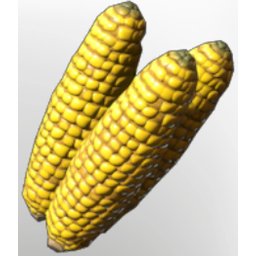

# Corncob

| | |
|---|---|
| Category | [Consumables](../../categories/consumables.md) |
| Rarity | ⚪ Common |
| Level | - |
| Max stack | 20 |
| Item ID | `3118804138` |
| Internal name | `Food_T1_raw_grain_Corncob` |

## Description

A very versatile crop that can be dried, grilled or consumed raw, strengthening the consumer for a short duration.

## Where to find

Springlands

## Stats

| | |
|---|---|
| Melee Damage | 3 |
| Duration | 10:00 min |

## Used to make

[Stir-Fried Vegetables](../../items/consumables/stir-fried-vegetables-1105965780.md), [Popcorn](../../items/consumables/popcorn-2382406755.md), [Fish Chowder](../../items/consumables/fish-chowder-1072066690.md), [T6 Fried Rice](../../items/consumables/t6-fried-rice-2285189073.md), [Roasted Corncob](../../items/consumables/roasted-corncob-4293773074.md), [Raw Meat and Corncob Skewer](../../items/materials/raw-meat-and-corncob-skewer-3975408930.md), [Corn Seedling](../../items/buildtools/corn-seedling-3660770821.md), [Bait Goat](../../items/buildtools/bait-goat-1545825068.md), [Food Bunny Feeding](../../items/buildtools/food-bunny-feeding-1674254183.md), [Food Goat Feeding](../../items/buildtools/food-goat-feeding-206667189.md), [Food Yak Feeding](../../items/buildtools/food-yak-feeding-3044969758.md)

---

[← Consumables](../../categories/consumables.md) · [All categories](../../README.md)
