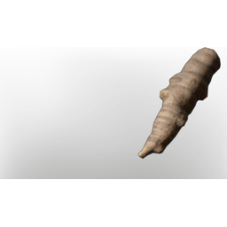

# Devil's Claw

| | |
|---|---|
| Category | [Consumables](../../categories/consumables.md) |
| Rarity | ⚪ Common |
| Level | - |
| Max stack | 100 |
| Item ID | `2065473526` |
| Internal name | `Food_T4_raw_herb_DevilsClaw` |

## Description

A resilient herb, growing in the harsh desert climate. Spiritualists were known to use it for unknown purposes...

## Where to find

Kindlewastes

## Stats

| | |
|---|---|
| Duration | 17:30 min |
| Mana | 80 |

## Used to make

[Devil's Claw Seedling](../../items/buildtools/devil-s-claw-seedling-1898312963.md)

---

[← Consumables](../../categories/consumables.md) · [All categories](../../README.md)
