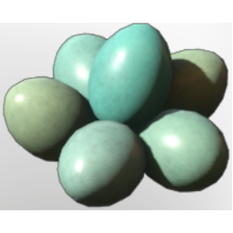

# Eggs

| | |
|---|---|
| Category | [Consumables](../../categories/consumables.md) |
| Rarity | ⚪ Common |
| Level | - |
| Max stack | 20 |
| Item ID | `1896276940` |
| Internal name | `Food_T3_raw_egg_BirdEggs` |

## Description

A great source of protein that enhances the muscle mass. Best consumed before a good exercise!

## Where to find

Nomad Highlands

## Stats

| | |
|---|---|
| Stamina | 15 |
| Duration | 10:00 min |
| Stamina Regeneration | 9 |

## Used to make

[Crab Cakes](../../items/consumables/crab-cakes-1453423195.md), [Yak Stew](../../items/consumables/yak-stew-2634459448.md), [Ancient Pomegranate Tarte](../../items/consumables/ancient-pomegranate-tarte-2202063914.md), [Mushroom Omelett](../../items/consumables/mushroom-omelett-2364777884.md), [Boiled Eggs](../../items/consumables/boiled-eggs-1136544436.md), [T6 Fried Rice](../../items/consumables/t6-fried-rice-2285189073.md), [Spaetzle with Mushroom Cream Sauce](../../items/consumables/spaetzle-with-mushroom-cream-sauce-1183822012.md), [Shortcrust Pastry Base](../../items/materials/shortcrust-pastry-base-3614911410.md)

---

[← Consumables](../../categories/consumables.md) · [All categories](../../README.md)
