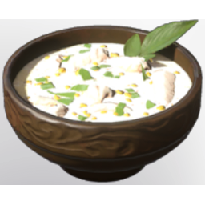

# Fish Chowder

| | |
|---|---|
| Category | [Consumables](../../categories/consumables.md) |
| Rarity | 🟣 Epic |
| Level | - |
| Max stack | 20 |
| Item ID | `1072066690` |
| Internal name | `Food_T4_dish_fish_fishChowderSoup` |

## Description

A hearty, creamy soup made with tender chunks of fish and fresh vegetables.

## Where to find

Kitchen

## Stats

| | |
|---|---|
| Health | 30 |
| Duration | 45:00 min |
| Maximum Oxygen | 30 |
| Stamina | 15 |
| Stamina Regeneration | 6 |

## How to get it

- **Kitchen**: 3 × [Corncob](../../items/consumables/corncob-3118804138.md), 2 × one of: Fish rare 03 name / Fish rare 01 name / Fish rare 02 name / Fish rare 04 name, 5 × [Forest Beet](../../items/consumables/forest-beet-3542827745.md), 5 × [Milk](../../items/consumables/milk-2873455991.md), 2 × [Flour](../../items/materials/flour-169532188.md) → 5 ×

---

[← Consumables](../../categories/consumables.md) · [All categories](../../README.md) · [JSON](fish-chowder-1072066690.json)
