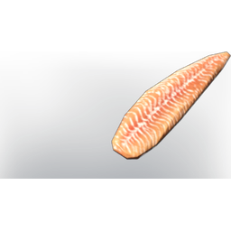

# Fish Filet

| | |
|---|---|
| Category | [Consumables](../../categories/consumables.md) |
| Rarity | 🔵 Rare |
| Level | - |
| Max stack | 20 |
| Item ID | `576061222` |
| Internal name | `Food_T6_raw_fish_FishFilet` |

## Description

The Filet from a rare fish, don't worry about any fish bones, they have been thoroughly removed.

## Where to find

Fisher

## Stats

| | |
|---|---|
| Health | 120 |
| Duration | 25:00 min |

## How to get it

- **Fish Trader**: 1 × one of: Fish epic 01 name / Fish epic 02 name / Fish epic 03 name / [Specklefin](../../items/consumables/specklefin-4122706847.md) / … (5 options), 1 × [T6 Material Gold Coins](../../items/materials/t6-material-gold-coins-2572858337.md) → 1 ×

## Used to make

[Seared Fish Filet](../../items/consumables/seared-fish-filet-1826581168.md)

---

[← Consumables](../../categories/consumables.md) · [All categories](../../README.md) · [JSON](fish-filet-576061222.json)
