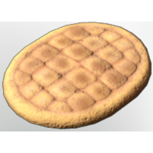

# Flat Bread

| | |
|---|---|
| Category | [Consumables](../../categories/consumables.md) |
| Rarity | 🟢 Uncommon |
| Level | - |
| Max stack | 20 |
| Item ID | `2160078991` |
| Internal name | `Food_T3_dish_grain_baked_FlatBread` |

## Description

A simple meal, granting a lasting Melee Damage boost upon consumption. It tastes better in combination with other things, though.

## Where to find

Oven

## Stats

| | |
|---|---|
| Duration | 40:00 min |
| Melee Damage | 12 |
| Stamina Regeneration | 9 |

## How to get it

- **Oven**: 2 × [Salt](../../items/materials/salt-1564406835.md), 3 × [Flour](../../items/materials/flour-169532188.md) → 5 ×

## Used to make

[Meat Wrap](../../items/consumables/meat-wrap-3744591176.md), [Fish Tacos](../../items/consumables/fish-tacos-71610791.md), [T4 Nightplant Wrap](../../items/consumables/t4-nightplant-wrap-2661195564.md), [Open Sandwich](../../items/consumables/open-sandwich-790393972.md)

---

[← Consumables](../../categories/consumables.md) · [All categories](../../README.md)
