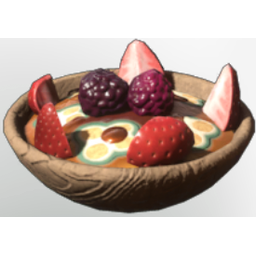

# Fruit Bowl

| | |
|---|---|
| Category | [Consumables](../../categories/consumables.md) |
| Rarity | 🟢 Uncommon |
| Level | - |
| Max stack | 20 |
| Item ID | `917304835` |
| Internal name | `Food_T4_dish_fruit_FruitBowl` |

## Description

A refreshing bowl of fruits with positive health benefits.

Boosts health and stamina regeneration upon consumption.

## Where to find

Kitchen

## Stats

| | |
|---|---|
| Health Regeneration | 15 |
| Duration | 45:00 min |
| Stamina Regeneration | 9 |

## How to get it

- **Kitchen**: 4 × [Date](../../items/consumables/date-4231900495.md), 4 × [Strawberry](../../items/consumables/strawberry-3479563223.md), 4 × [Red Berries](../../items/consumables/red-berries-3707271437.md), 5 × [Yucca Fruit](../../items/consumables/yucca-fruit-2008478235.md), 4 × [Night Berry](../../items/consumables/night-berry-3173308572.md), 4 × [Honey](../../items/consumables/honey-227143323.md) → 5 ×

---

[← Consumables](../../categories/consumables.md) · [All categories](../../README.md)
