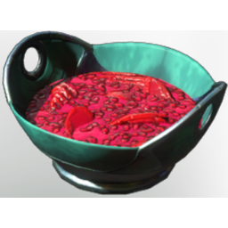

# Fruit Salad

| | |
|---|---|
| Category | [Consumables](../../categories/consumables.md) |
| Rarity | 🟢 Uncommon |
| Level | - |
| Max stack | 20 |
| Item ID | `270916101` |
| Internal name | `Food_T7_dish_fruit_FruitSalad` |

## Description

predominantly ancient fruits mixed together into a refreshing fruit salad

## Where to find

Kitchen

## Stats

| | |
|---|---|
| Duration | 60:00 min |
| Health Regeneration | 24 |

## How to get it

- **Kitchen**: 5 × [Ancient "Pomegranate"](../../items/consumables/ancient-pomegranate-1321928315.md), 5 × [Ancient "Artichoke"](../../items/consumables/ancient-artichoke-426586658.md), 5 × [Strawberry](../../items/consumables/strawberry-3479563223.md), 5 × [Date](../../items/consumables/date-4231900495.md) → 5 ×

---

[← Consumables](../../categories/consumables.md) · [All categories](../../README.md)
