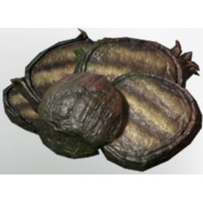

# Grilled Algae Buds

| | |
|---|---|
| Category | [Consumables](../../categories/consumables.md) |
| Rarity | 🟢 Uncommon |
| Level | - |
| Max stack | 20 |
| Item ID | `3423336686` |
| Internal name | `Food_T6_processed_herb_AlgaeBuds` |

## Description

These grilled  algae buds can be sprinkeld upon your food to make it taste even better and they have some hidden benefits.

## Where to find

Seafood Grill

## Stats

| | |
|---|---|
| Mana | 140 |
| Duration | 50:00 min |

## How to get it

- **Medieval Grill**: 1 × [Algae Buds](../../items/consumables/algae-buds-2448218322.md) → 1 ×

## Used to make

[Grilled Fish with Coconut Rice](../../items/consumables/grilled-fish-with-coconut-rice-4166256477.md)

---

[← Consumables](../../categories/consumables.md) · [All categories](../../README.md)
