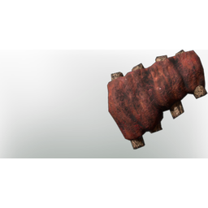

# Grilled Wolf Meat

| | |
|---|---|
| Category | [Consumables](../../categories/consumables.md) |
| Rarity | 🟢 Uncommon |
| Level | - |
| Max stack | 20 |
| Item ID | `3373898672` |
| Internal name | `Food_T1_processed_meat_Grilled_WolfMeat` |

## Description

Roasted ribs were a delicacy back in the day, granting a good amount of constitution to the consumer...

## Where to find

Campfire

## Stats

| | |
|---|---|
| Duration | 20:00 min |
| Health | 60 |

## How to get it

- **Cooking Station**: 1 × [Raw Wolf Meat](../../items/consumables/raw-wolf-meat-2968802610.md) → 1 ×

## Used to make

[Open Sandwich](../../items/consumables/open-sandwich-790393972.md), [Tar](../../items/materials/tar-1714627847.md)

---

[← Consumables](../../categories/consumables.md) · [All categories](../../README.md) · [JSON](grilled-wolf-meat-3373898672.json)
