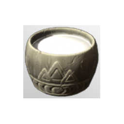

# Mountaingoat Milk

| | |
|---|---|
| Category | [Consumables](../../categories/consumables.md) |
| Rarity | ⚪ Common |
| Level | - |
| Max stack | 100 |
| Item ID | `443792978` |
| Internal name | `Food_T5_raw_hydration_MountaingoatMilk` |

## Description

A delicious jug of Mountain Goat milk. Drinking it will grant you endurance.

## Where to find

Albaneve Summits, Tamed Frizzy Goat

## Stats

| | |
|---|---|
| Stamina Regeneration | 21 |
| Duration | 15:00 min |
| Stamina | 25 |

## Used to make

[Yak Stew](../../items/consumables/yak-stew-2634459448.md), [Pumpkin Soup](../../items/consumables/pumpkin-soup-2905059781.md), [T5 Milkshake Dish](../../items/consumables/t5-milkshake-dish-439577610.md), [Spaetzle with Mushroom Cream Sauce](../../items/consumables/spaetzle-with-mushroom-cream-sauce-1183822012.md)

---

[← Consumables](../../categories/consumables.md) · [All categories](../../README.md) · [JSON](mountaingoat-milk-443792978.json)
