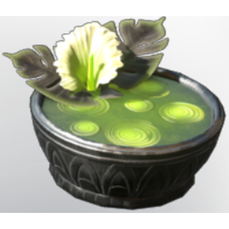

# Nightplant Soup

| | |
|---|---|
| Category | [Consumables](../../categories/consumables.md) |
| Rarity | 🔵 Rare |
| Level | - |
| Max stack | 20 |
| Item ID | `587195934` |
| Internal name | `Food_T3_dish_nightplant_Soup` |

## Description

A soup made from various vegetables full of vitamins and energy. It glows in the dark and extends your time in the shroud!

## Where to find

Kitchen

## Stats

| | |
|---|---|
| Mana | 40 |
| Fog Survivability Extension | 120,000 |
| Duration | 40:00 min |
| Mana Regeneration | 6 |

## How to get it

- **Kitchen**: 1 × [Salt](../../items/materials/salt-1564406835.md), 3 × [Aurum Lily](../../items/materials/aurum-lily-2341333485.md), 5 × [Sage Leaves](../../items/consumables/sage-leaves-3562500384.md) → 5 ×

---

[← Consumables](../../categories/consumables.md) · [All categories](../../README.md)
